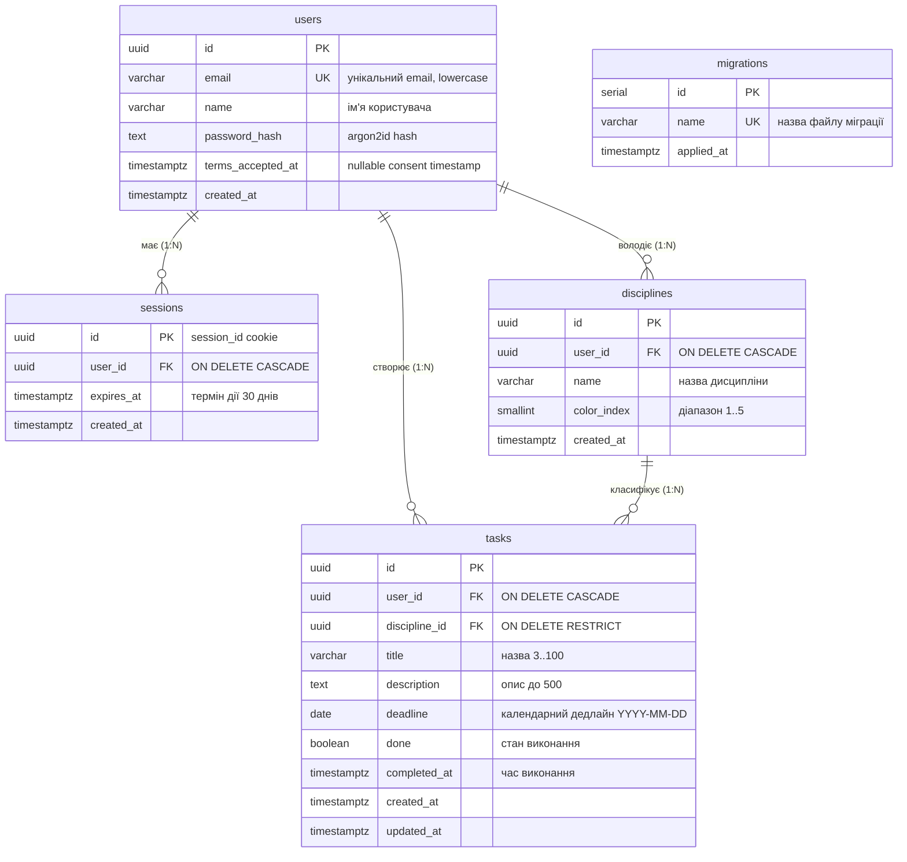

# Модель даних та реляційна схема StudyPlanner

Цей документ описує структуру реляційної бази даних застосунку **StudyPlanner**, перелік таблиць, типи даних, первинні та зовнішні ключі, обмеження цілісності (constraints), індекси, ER-діаграму у форматі Mermaid та стратегію ідемпотентних міграцій.

---

## 1. Схема таблиць бази даних (PostgreSQL)

База даних використовує вбудовану функцію `gen_random_uuid()` (стандарт PostgreSQL v13+ / розширення `pgcrypto`) для генерації випадкових криптографічно безпечних унікальних ідентифікаторів версії 4.

### 1.1. Таблиця `users` (Користувачі)
Зберігає облікові записи користувачів системи.

| Стовпець | Тип даних | Обмеження | Опис |
|---|---|---|---|
| `id` | `UUID` | `PRIMARY KEY DEFAULT gen_random_uuid()` | Унікальний ідентифікатор користувача |
| `email` | `VARCHAR(255)` | `UNIQUE NOT NULL` | Електронна пошта у нижньому регістрі (`lowercase`) |
| `name` | `VARCHAR(100)` | `NOT NULL` | Ім'я або псевдонім користувача (від 2 до 100 симв.) |
| `password_hash` | `TEXT` | `NOT NULL` | Хеш пароля алгоритму `argon2id` або `bcrypt` |
| `terms_accepted_at` | `TIMESTAMPTZ` | `NULL` | Час підтвердження згоди з умовами під час реєстрації; для наявних акаунтів лишається `NULL` |
| `created_at` | `TIMESTAMPTZ` | `NOT NULL DEFAULT NOW()` | Мітка часу реєстрації користувача в UTC |

### 1.2. Таблиця `sessions` (Серверні сесії)
Зберігає активні сесії автентифікації користувачів.

| Стовпець | Тип даних | Обмеження | Опис |
|---|---|---|---|
| `id` | `UUID` | `PRIMARY KEY DEFAULT gen_random_uuid()` | Непрозорий сесійний токен (передається в cookie) |
| `user_id` | `UUID` | `NOT NULL REFERENCES users(id) ON DELETE CASCADE` | Власник сесії |
| `expires_at` | `TIMESTAMPTZ` | `NOT NULL` | Момент часу, коли термін дії сесії спливає |
| `created_at` | `TIMESTAMPTZ` | `NOT NULL DEFAULT NOW()` | Час створення сесії |

### 1.3. Таблиця `disciplines` (Навчальні дисципліни)
Зберігає перелік дисциплін, які створюються користувачем (вручну або автоматично при створенні завдання).

| Стовпець | Тип даних | Обмеження | Опис |
|---|---|---|---|
| `id` | `UUID` | `PRIMARY KEY DEFAULT gen_random_uuid()` | Унікальний ідентифікатор дисципліни |
| `user_id` | `UUID` | `NOT NULL REFERENCES users(id) ON DELETE CASCADE` | Користувач-власник дисципліни |
| `name` | `VARCHAR(100)` | `NOT NULL` | Назва дисципліни (від 2 до 100 символів) |
| `color_index` | `SMALLINT` | `NOT NULL CHECK (color_index BETWEEN 1 AND 5)` | Номер палітри кольору (від 1 до 5) |
| `created_at` | `TIMESTAMPTZ` | `NOT NULL DEFAULT NOW()` | Час створення дисципліни |

- **Складене обмеження унікальності (Case-Insensitive):**
  ```sql
  CREATE UNIQUE INDEX uq_disciplines_user_lower_name ON disciplines (user_id, lower(name));
  ```
  Запобігає дублюванню дисциплін з однаковою назвою у різному регістрі для одного користувача.

### 1.4. Таблиця `tasks` (Завдання)
Основна сутність для збереження навчальних завдань студента.

| Стовпець | Тип даних | Обмеження | Опис |
|---|---|---|---|
| `id` | `UUID` | `PRIMARY KEY DEFAULT gen_random_uuid()` | Унікальний ідентифікатор завдання |
| `user_id` | `UUID` | `NOT NULL REFERENCES users(id) ON DELETE CASCADE` | Користувач-власник завдання |
| `discipline_id`| `UUID` | `NOT NULL REFERENCES disciplines(id) ON DELETE RESTRICT` | Прив'язана дисципліна |
| `title` | `VARCHAR(100)` | `NOT NULL CHECK (char_length(trim(title)) >= 3)` | Назва завдання (від 3 до 100 символів) |
| `description` | `TEXT` | `CHECK (char_length(description) <= 500)` | Детальний опис завдання (до 500 симв., nullable) |
| `deadline` | `DATE` | `NOT NULL` | Календарна дата дедлайну без часового поясу |
| `done` | `BOOLEAN` | `NOT NULL DEFAULT false` | Прапорець виконання |
| `completed_at` | `TIMESTAMPTZ` | `NULL` | Фіксація часу виконання (заповнюється при `done=true`) |
| `created_at` | `TIMESTAMPTZ` | `NOT NULL DEFAULT NOW()` | Час створення запису |
| `updated_at` | `TIMESTAMPTZ` | `NOT NULL DEFAULT NOW()` | Час останньої модифікації завдання |

### 1.5. Таблиця `migrations` (Облік застосованих міграцій)
Службова таблиця раннера міграцій.

| Стовпець | Тип даних | Обмеження | Опис |
|---|---|---|---|
| `id` | `SERIAL` | `PRIMARY KEY` | Порядковий номер міграції |
| `name` | `VARCHAR(255)` | `UNIQUE NOT NULL` | Назва файлу міграції (напр., `001_create_extensions.sql`) |
| `applied_at` | `TIMESTAMPTZ` | `NOT NULL DEFAULT NOW()` | Точний час виконання міграції |

---

## 2. Індекси продуктивності (B-Tree Indexes)

Для забезпечення максимальної швидкодії фільтрації, сортування та автентифікації створено спеціальні індекси:

```sql
-- 1. Швидкий пошук активних сесій за ідентифікатором користувача та за датою завершення
CREATE INDEX idx_sessions_user_id ON sessions(user_id);
CREATE INDEX idx_sessions_expires_at ON sessions(expires_at);

-- 2. Швидка вибірка та сортування завдань за дедлайном (для списку груп та календаря)
CREATE INDEX idx_tasks_user_deadline ON tasks(user_id, deadline);

-- 3. Швидка фільтрація завдань за станом виконання (активні / виконані)
CREATE INDEX idx_tasks_user_done ON tasks(user_id, done);

-- 4. Швидке отримання списку дисциплін користувача
CREATE INDEX idx_disciplines_user ON disciplines(user_id);

-- 5. Захист від повного сканування таблиці tasks при перевірці зовнішнього ключа дисципліни
CREATE INDEX idx_tasks_discipline_id ON tasks(discipline_id);
```

---

## 3. ER-діаграма зв'язків сутностей (Mermaid)



---

## 4. Обмеження цілісності та поведінка зовнішніх ключів (Foreign Keys)

1. **`users` -> `sessions` (`ON DELETE CASCADE`):**
   При видаленні користувача (через `POST /api/account/delete`) усі його активні сесії автоматично та миттєво знищуються, що запобігає можливості повторного входу за старими cookie.
2. **`users` -> `disciplines` (`ON DELETE CASCADE`):**
   При видаленні облікового запису всі створені ним навчальні дисципліни видаляються разом із профілем.
3. **`users` -> `tasks` (`ON DELETE CASCADE`):**
   При видаленні облікового запису всі створені ним навчальні завдання безповоротно видаляються.
4. **`disciplines` -> `tasks` (`ON DELETE RESTRICT`):**
   Дисципліну заборонено видаляти з бази даних, якщо до неї прив'язано хоча б одне завдання користувача. Це запобігає виникненню помилок розриву посилальної цілісності у клієнтському інтерфейсі та гарантує, що кожне завдання завжди має валідний колір і назву дисципліни.

---

## 5. Стратегія та механізм міграцій (Migrations Strategy)

У проекті свідомо обрано підхід **Plain SQL Migrations** без використання важких сторонніх інструментів (наприклад, Knex чи Flyway), що гарантує максимальну прозорість, відсутність сторонніх вразливостей і легкість виконання на Windows через PowerShell.

### 5.1. Структура файлів міграцій
Міграції зберігаються у теці `server/src/db/migrations/` та мають строгий порядковий числовий префікс:
- `001_create_extensions.sql` — увімкнення розширень (`CREATE EXTENSION IF NOT EXISTS "pgcrypto";`).
- `002_create_users.sql` — створення таблиці `users` та індексів.
- `003_create_sessions.sql` — створення таблиці `sessions` та індексів.
- `004_create_disciplines.sql` — створення таблиці `disciplines`, індексів та обмеження `color_index`.
- `005_create_tasks.sql` — створення таблиці `tasks`, тригера `updated_at` та індексів.
- `006_add_terms_accepted_at.sql` — додавання часу згоди з умовами до облікового запису.

### 5.2. Робота раннера міграцій (`server/src/db/migrate.js`)
Раннер реалізує повністю ідемпотентний алгоритм:
1. Підключається до бази даних за рядком `DATABASE_URL` (або `TEST_DATABASE_URL`).
2. Створює таблицю `migrations`, якщо вона ще не існує (`CREATE TABLE IF NOT EXISTS migrations ...`).
3. Виконує запит `SELECT name FROM migrations` і формує перелік уже застосованих файлів.
4. Зчитує вміст директорії `server/src/db/migrations/`, сортує файли за алфавітом/номером.
5. Для кожного нового файлу:
   - Відкриває окрему транзакцію БД (`BEGIN`).
   - Виконує SQL-команди з файлу.
   - Записує назву файлу у таблицю `migrations` (`INSERT INTO migrations (name) VALUES ($1)`).
   - Фіксує транзакцію (`COMMIT`).
6. У разі будь-якої помилки транзакція відкочується (`ROLLBACK`), процес завершується з ненульовим кодом помилки, а база залишається у попередньому стабільному стані.

### 5.3. Команди запуску міграцій
- `npm run migrate`: одноразове застосування всіх незастосованих міграцій на поточній базі даних.
- `npm run migrate:status`: виведення списку виконаних та очікуваних міграцій у консоль.
